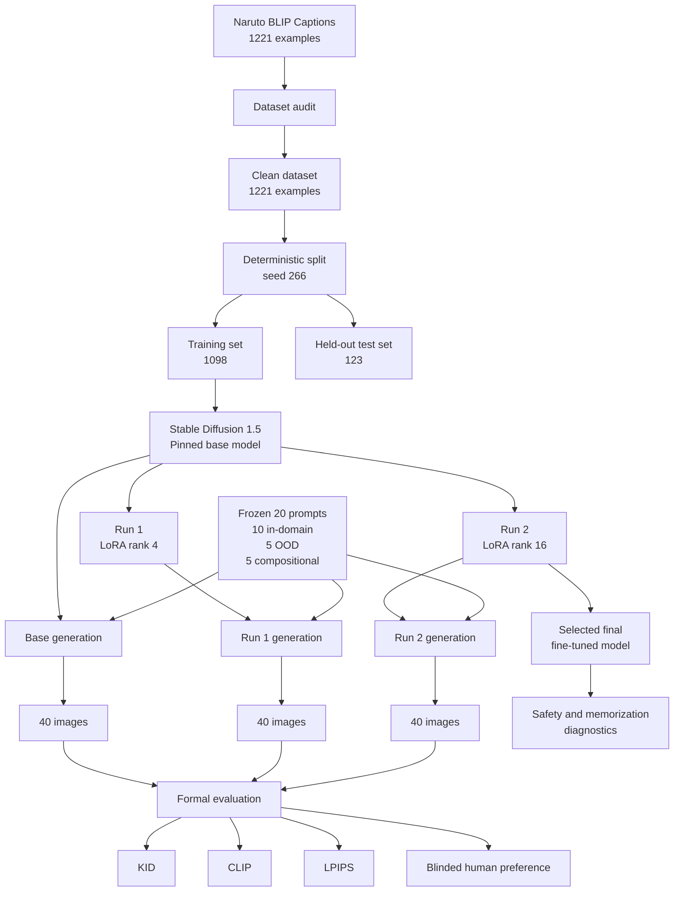
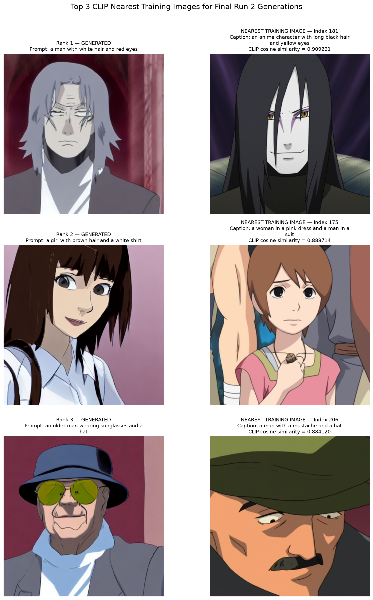
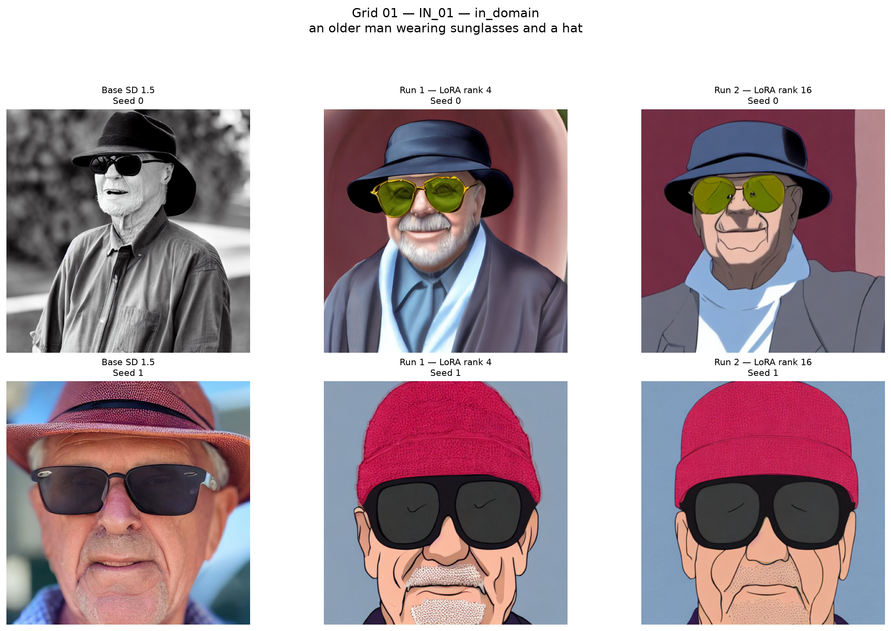
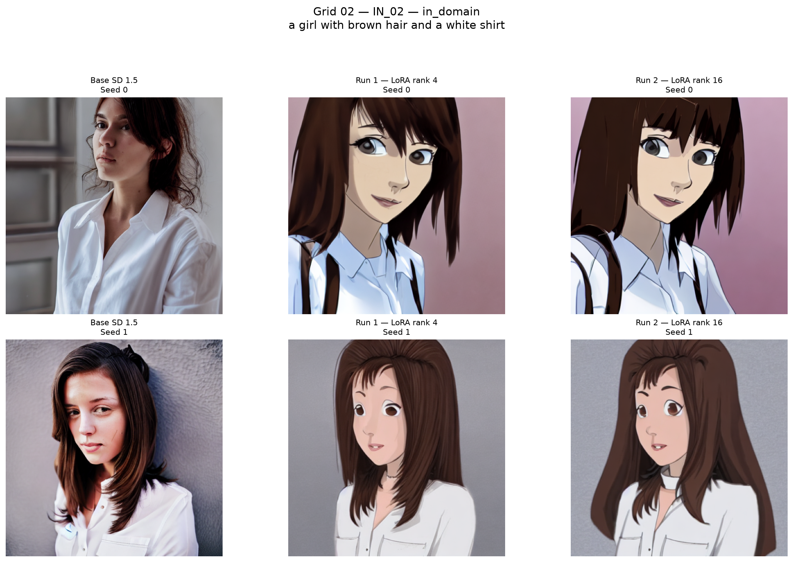
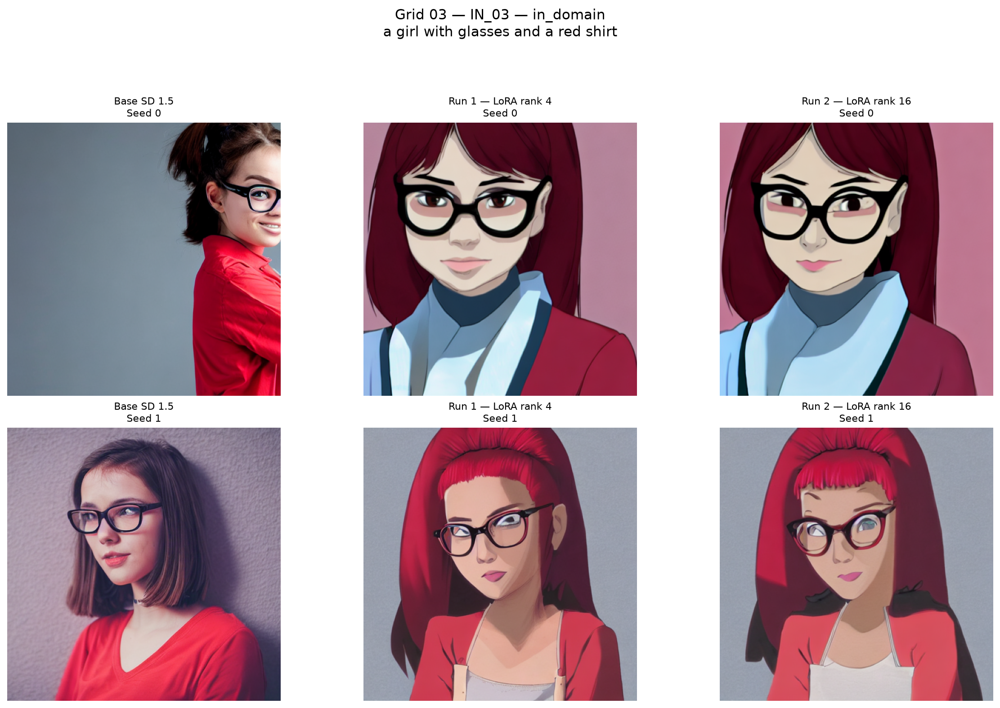
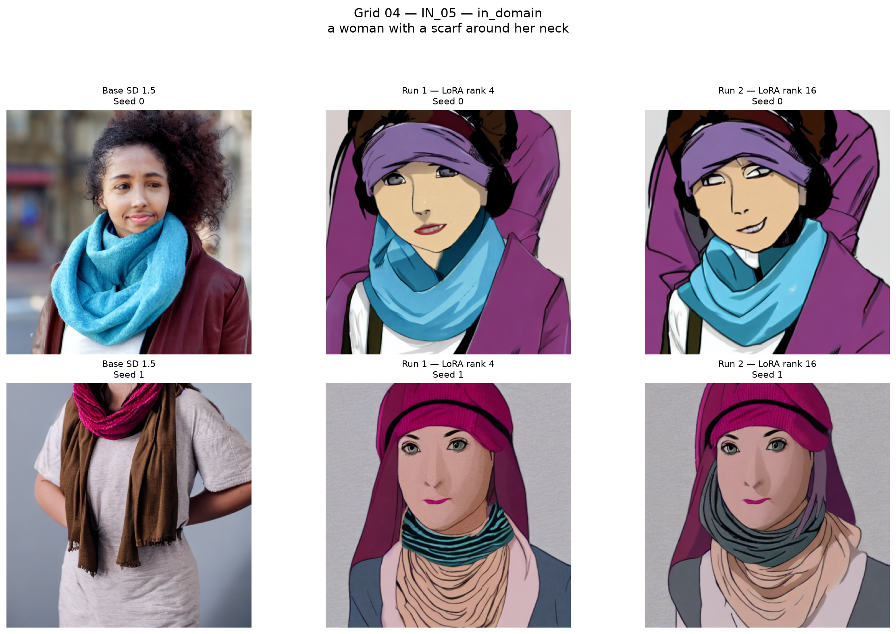
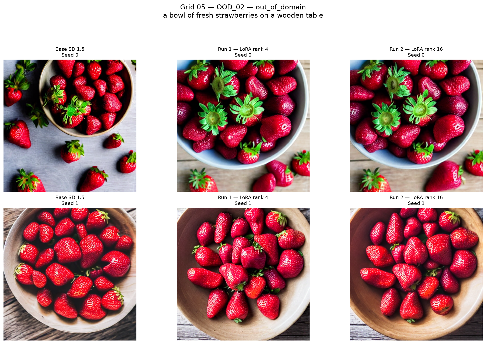
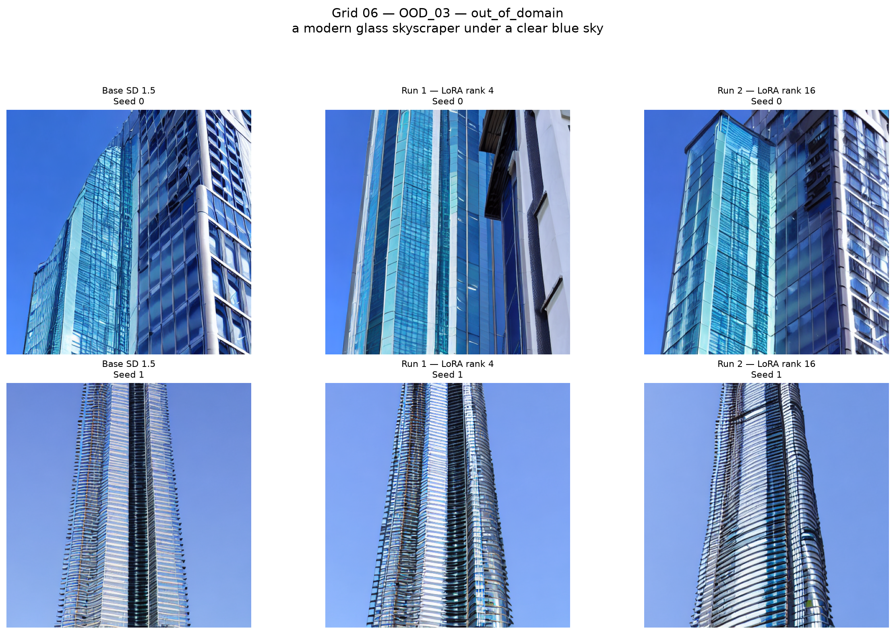
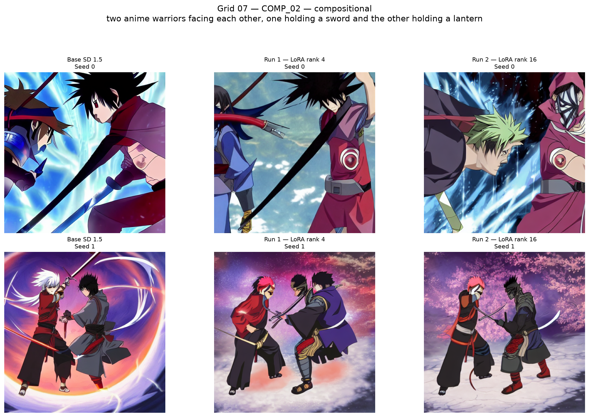
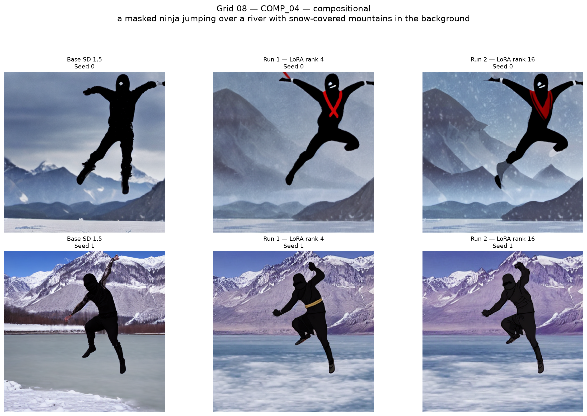

# DATA 266 Lab 2 - Part 2

## Domain Fine-Tuning Stable Diffusion 1.5 with LoRA on Naruto BLIP Captions

**Student:** Anshika Goel

**GitHub repository:** [https://github.com/99GoelAnshika/data266-lab2-team15](https://github.com/99GoelAnshika/data266-lab2-team15)

This project fine-tunes Stable Diffusion 1.5 on the Naruto BLIP Captions domain using two controlled LoRA configurations and compares both fine-tuned models with the unchanged Base Stable Diffusion 1.5 model.

The experiment is designed as an apples-to-apples comparison. Run 1 and Run 2 use the same training examples, training schedule, learning rate, optimizer-step budget, effective batch size, generation prompts, generation settings, and evaluation procedure. The primary controlled difference is LoRA rank.

The selected final fine-tuned model is **Run 2, LoRA rank 16**. The evidence does not show that Run 2 is universally superior to Base: Run 2 obtains the strongest in-domain KID result, whereas Base retains the highest overall CLIP alignment and receives stronger blinded human preference.

---

## 1. Project Objective

The goals of Part 2 are to:

1. start from one pretrained text-to-image base model;
2. perform two controlled fine-tuning runs;
3. compare the two LoRA models with the unchanged Base model;
4. generate all conditions under one frozen prompt and inference protocol;
5. evaluate the models with exactly four formal evaluation types;
6. report training efficiency, safety behavior, memorization screening, and qualitative failure modes separately;
7. publish both adapters and all official generations to Hugging Face.

---

## 2. Experiment Architecture



---

## 3. Base Model

| Item | Value |
|---|---|
| Base model | `stable-diffusion-v1-5/stable-diffusion-v1-5` |
| Pinned revision | `451f4fe16113bff5a5d2269ed5ad43b0592e9a14` |
| Model family | Stable Diffusion 1.5 |
| Fine-tuning method | LoRA |
| Resolution | 512 x 512 |
| Mixed precision | `fp16` |

A memory-conscious configuration allowed the experiment to run locally on an NVIDIA RTX 3060 Laptop GPU with 6 GB VRAM.

A Base-model smoke test was completed before the official experiment:

[`results/base_model_smoke_test.json`](results/base_model_smoke_test.json)

---

## 4. Dataset

**Dataset:** `lambdalabs/naruto-blip-captions`

**Pinned revision:** `1ed13e8ef280bd45e3bbac4cfa8bbd9d64ec9f89`

The dataset card reports that the source images were obtained from Narutopedia and that captions were generated automatically using a pretrained BLIP captioning model.

### 4.1 Data-quality audit

| Audit item | Result |
|---|---:|
| Original examples | 1221 |
| Corrupted images removed | 0 |
| Invalid captions removed | 0 |
| Exact duplicate rows removed | 0 |
| Perceptual duplicate candidates | 0 |
| Final cleaned examples | 1221 |

### 4.2 Deterministic split

Split seed: **266**

| Split | Examples |
|---|---:|
| Training | 1098 |
| Held-out test | 123 |
| Total | 1221 |

The held-out test examples were not used during fine-tuning.

Split manifests:

- [`eval/train_split_indices.csv`](eval/train_split_indices.csv)
- [`eval/test_split_indices.csv`](eval/test_split_indices.csv)

### 4.3 Dataset limitations

**Machine-generated caption noise**

Captions were generated with a pretrained BLIP model rather than manually verified, so captions may be generic, incomplete, grammatically imperfect, or visually misaligned.

**Narrow-domain sampling bias**

The dataset contains Naruto-related anime imagery and is not representative of a broad natural-image or general text-to-image distribution.

### 4.4 Dataset license

**No explicit dataset license is declared in the pinned Hugging Face repository metadata.**

No license is inferred when the publisher does not explicitly declare one.

The imagery also comes from a pre-existing entertainment franchise, so downstream redistribution or commercial-use rights require separate consideration beyond this course experiment.

---

## 5. Frozen Evaluation Prompt Set

The evaluation prompt set was fixed before the full fine-tuning experiment was completed.

| Category | Prompts | Seeds | Images/model |
|---|---:|---|---:|
| Held-out in-domain | 10 | 0, 1 | 20 |
| Out-of-domain | 5 | 0, 1 | 10 |
| Compositional | 5 | 0, 1 | 10 |
| **Total** | **20** | **0, 1** | **40** |

Therefore:

**40 images/model x 3 model conditions = 120 official generations**

Prompt manifest:

[`eval/evaluation_prompts_20.csv`](eval/evaluation_prompts_20.csv)

---

## 6. Fine-Tuning Design

Both LoRA runs used the same schedule hash:

`fd89961bd868e07d308345cc6de4b5633c9ea78eb69b7b54a69af9241ea28712`

| Setting | Run 1 | Run 2 |
|---|---:|---:|
| LoRA rank | 4 | 16 |
| LoRA alpha | 4 | 16 |
| Trainable parameters | 797,184 | 3,188,736 |
| Trainable percentage | 0.092662% | 0.369619% |
| Optimizer | AdamW | AdamW |
| Learning rate | 0.0001 | 0.0001 |
| Physical batch size | 1 | 1 |
| Gradient accumulation | 4 | 4 |
| Effective batch size | 4 | 4 |
| Optimizer steps | 1000 | 1000 |
| Sample exposures | 4000 | 4000 |
| Equivalent epochs | 3.6430 | 3.6430 |
| Mixed precision | fp16 | fp16 |
| Gradient checkpointing | True | True |

LoRA target modules:

`to_q, to_k, to_v, to_out.0`

Frozen training protocol:

[`eval/fine_tuning_protocol.json`](eval/fine_tuning_protocol.json)

---

## 7. Training Results and Efficiency

| Result | Run 1 rank 4 | Run 2 rank 16 |
|---|---:|---:|
| First 50-step mean loss | 0.091024 | 0.090991 |
| Last 50-step mean loss | 0.083992 | 0.083833 |
| Overall mean loss | 0.086996 | 0.086895 |
| Training minutes | 55.06 | 56.01 |
| GPU-hours | 0.9177 | 0.9336 |
| Peak allocated GPU memory | 2.4723 GB | 2.5116 GB |
| Final adapter size | 3.0767 MB | 12.2003 MB |

Increasing rank from 4 to 16 increased trainable capacity by **4.0x**, while:

- training time increased only **1.73%**;
- GPU-hours increased **1.73%**;
- peak allocated GPU memory increased **1.59%**;
- adapter file size increased about **3.97x**.

Efficiency is a resource-use analysis and is not treated as an additional formal evaluation type.

---

## 8. Official Generation Protocol

| Setting | Value |
|---|---|
| Resolution | 512 x 512 |
| Scheduler | `PNDMScheduler` |
| Inference steps | 30 |
| Guidance scale | 7.5 |
| Seeds | [0, 1] |
| Safety checker | Enabled |
| Images/model | 40 |
| Total official images | 120 |

Protocol:

[`eval/generation_protocol.json`](eval/generation_protocol.json)

---

# 9. Formal Evaluation

Exactly **four formal evaluation types** were used:

1. **Kernel Inception Distance (KID)**
2. **CLIP prompt-image alignment**
3. **LPIPS seed diversity**
4. **Blinded human preference**

Safety filtering, memorization screening, efficiency analysis, qualitative comparison, and failure analysis are supporting diagnostics rather than additional evaluation types.

---

## 9.1 Kernel Inception Distance

Lower KID is better.

The 20 in-domain generated images from each condition were compared with all 123 held-out real test images.

| Model | KID mean | KID std | Rank |
|---|---:|---:|---:|
| **Run 2 rank 16** | **0.034975** | 0.005391 | **1** |
| Run 1 rank 4 | 0.089212 | 0.008847 | 2 |
| Base | 0.144058 | 0.013823 | 3 |

**Interpretation:** Run 2 provides the strongest in-domain distribution match and substantially improves KID relative to both Run 1 and Base.

This supports successful Naruto-domain adaptation, although KID does not directly measure semantic correctness or human preference.

---

## 9.2 CLIP Prompt-Image Alignment

Higher CLIP cosine similarity is better.

| Model | Mean CLIP similarity | Rank |
|---|---:|---:|
| **Base** | **0.324159** | **1** |
| Run 2 rank 16 | 0.312618 | 2 |
| Run 1 rank 4 | 0.309442 | 3 |

**Interpretation:** Base retains the strongest overall prompt-image alignment.

Run 2 performs slightly better than Run 1, but neither fine-tuned model surpasses Base on overall CLIP alignment.

---

## 9.3 LPIPS Seed Diversity

Higher LPIPS here indicates greater perceptual difference between seed 0 and seed 1 for the same prompt.

| Model | Official mean LPIPS | Clean-pair mean |
|---|---:|---:|
| **Base** | **0.752897** | **0.752897** |
| Run 2 rank 16 | 0.751837 | 0.715023 |
| Run 1 rank 4 | 0.663034 | 0.725435 |

Official LPIPS intentionally includes safety-filtered outputs.

The clean-pair values are therefore reported as a diagnostic breakdown of the same LPIPS evaluation and are not counted as an additional evaluation type.

---

## 9.4 Blinded Human Preference

Run 2 was compared directly against Base using:

- **25 blinded pairs**
- **3 raters**
- **75 total judgments**
- randomized left/right placement

| Judgment | Count | Share |
|---|---:|---:|
| Run 2 preferred | 15 | 20.00% |
| Base preferred | 31 | 41.33% |
| Tie | 29 | 38.67% |

Among decisive judgments:

- Run 2 win rate: **32.61%**
- Base win rate: **67.39%**

Pair-majority outcomes:

| Outcome | Number of pairs |
|---|---:|
| Run 2 majority | 4 |
| Base majority | 9 |
| Tie majority | 9 |
| No majority | 3 |

**Interpretation:** Base was preferred more frequently by human raters overall despite Run 2's substantially improved in-domain KID.

Blinded stimuli:

[`figures/human_eval_blinded_pairs/`](figures/human_eval_blinded_pairs/)

---

## 10. Overall Comparison

| Metric | Base | Run 1 rank 4 | Run 2 rank 16 | Best |
|---|---:|---:|---:|---|
| KID - lower better | 0.144058 | 0.089212 | **0.034975** | Run 2 |
| CLIP - higher better | **0.324159** | 0.309442 | 0.312618 | Base |
| LPIPS diversity - higher | **0.752897** | 0.663034 | 0.751837 | Base |
| Human preference share | **41.33%** | Not evaluated | 20.00% | Base |

Human ties account for **38.67%** of all judgments.

---

## 11. Why Run 2 Was Selected as the Final Fine-Tuned Model

Run 2 was frozen as the final fine-tuned candidate before human-evaluation results were unblinded.

Relative to Run 1, Run 2 had:

- substantially lower KID;
- slightly stronger overall CLIP alignment;
- stronger compositional CLIP alignment;
- fewer safety-filtered generations;
- almost the same training time;
- only a small increase in peak GPU memory.

Therefore, **Run 2 rank 16 is the stronger of the two fine-tuned candidates**.

This should not be confused with claiming that Run 2 is the strongest model under every metric. Overall CLIP and blinded human preference favor Base.

---

## 12. Safety Filtering

The Stable Diffusion safety checker remained enabled during official generation.

| Model | Images | Safety-filtered |
|---|---:|---:|
| Base | 40 | 0 |
| Run 1 rank 4 | 40 | 5 |
| Run 2 rank 16 | 40 | 3 |

Filtered outputs were retained unchanged rather than regenerated or replaced.

A safety-checker flag is not automatically evidence that an image contains confirmed harmful material; false positives and domain shift may contribute.

---

## 13. Memorization Screening

The selected Run 2 model was screened for possible training-image memorization.

- generated images screened: **10**
- training images searched: **1098**
- top nearest-neighbor pairs visually inspected: **3**
- highest CLIP similarity: **0.909221**
- visually identified near duplicates: **0**

**Assessment:** No clear visual evidence of direct training-image copying was observed among the three highest-CLIP nearest neighbors.

**Limitation:** This is a screening analysis, not proof that memorization is absent. CLIP similarity captures semantic and stylistic resemblance as well as visual similarity, and only ten generated images were screened.



Memorization screening is a safety diagnostic, not a fifth formal evaluation type.

---

## 14. Qualitative Comparison

Eight comparison grids were selected deterministically using seed **266**. Selection did not depend on image quality.

### In-domain









**Observation:** Base SD 1.5 frequently remains photographic or semi-photographic, while both LoRA runs consistently shift the selected in-domain generations toward the Naruto/anime visual domain.

### Out-of-domain





**Observation:** For the selected strawberry and skyscraper prompts, all three models preserve the major requested semantic content, indicating that fine-tuning did not eliminate general text-to-image capability.

### Compositional





**Observation:** The compositional examples reveal failures in object binding and complete multi-element spatial composition.

---

## 15. Failure Modes

### 15.1 Multi-object attribute binding

`COMP_02` requires two warriors, one with a sword and one with a lantern.

The models commonly preserve the two-character scene but fail to bind the requested objects reliably to the correct subjects. The lantern may disappear, become weapon-like, or be replaced by another object.

### 15.2 Multi-element spatial composition

`COMP_04` requires a masked ninja jumping over a river with snowy mountains in the background.

The ninja, action, and mountain setting are generally captured, but the river is not consistently represented as a distinct spatial component.

These failures show that domain adaptation does not remove known text-to-image weaknesses in object binding and complex spatial composition.

---

## 16. Hugging Face Publications

| Artifact | Repository |
|---|---|
| Run 1 rank-4 LoRA | [99AnshikaGoel/data266-lab2-part2-run1-lora-rank4](https://huggingface.co/99AnshikaGoel/data266-lab2-part2-run1-lora-rank4) |
| Run 2 rank-16 LoRA + model card | [99AnshikaGoel/data266-lab2-part2-run2-lora-rank16](https://huggingface.co/99AnshikaGoel/data266-lab2-part2-run2-lora-rank16) |
| 120 official generated images | [99AnshikaGoel/data266-lab2-part2-generated-images](https://huggingface.co/datasets/99AnshikaGoel/data266-lab2-part2-generated-images) |

Remote verification confirmed:

- Run 1 adapter verified: **True**
- Run 2 adapter verified: **True**
- Run 2 model card verified: **True**
- Base images: **40**
- Run 1 images: **40**
- Run 2 images: **40**
- total remote images: **120**
- local/remote PNG byte totals match: **True**

Generated images and LoRA checkpoints are intentionally not stored in GitHub.

---

## 17. Final Model Card

Local model card:

[`model_cards/run2_rank16/README.md`](model_cards/run2_rank16/README.md)

Published model card:

[https://huggingface.co/99AnshikaGoel/data266-lab2-part2-run2-lora-rank16](https://huggingface.co/99AnshikaGoel/data266-lab2-part2-run2-lora-rank16)

---

## 18. Reproducibility

### Environment

Package versions are pinned in:

[`requirements.txt`](requirements.txt)

### Executed notebook

[`notebooks/p2_finetune.ipynb`](notebooks/p2_finetune.ipynb)

The notebook contains saved outputs for the complete experiment, including training, generation, all four formal evaluations, safety checks, memorization screening, qualitative analysis, and Hugging Face publication records.

### Important controls

| Control | Value |
|---|---|
| Dataset split seed | 266 |
| Training stochastic seed | 266 |
| Generation seeds | 0 and 1 |
| Frozen prompt count | 20 |
| Base revision | `451f4fe16113bff5a5d2269ed5ad43b0592e9a14` |
| Dataset revision | `1ed13e8ef280bd45e3bbac4cfa8bbd9d64ec9f89` |
| Training schedule hash | `fd89961bd868e07d308345cc6de4b5633c9ea78eb69b7b54a69af9241ea28712` |
| Test examples used for training | 0 |

### Environment setup

From the repository root:

```powershell
cd "Part2\AnshikaGoel"

python -m venv .venv

.\.venv\Scripts\Activate.ps1

pip install -r requirements.txt

jupyter lab
```

Then open:

`notebooks/p2_finetune.ipynb`

---

## 19. Repository Structure

```text
Part2/AnshikaGoel/
|
+-- README.md
+-- requirements.txt
|
+-- notebooks/
|   +-- p2_finetune.ipynb
|
+-- eval/
|   +-- evaluation_prompts_20.csv
|   +-- generation_protocol.json
|   +-- fine_tuning_protocol.json
|   +-- train_split_indices.csv
|   +-- test_split_indices.csv
|   +-- ...
|
+-- results/
|   +-- run1_training_summary.json
|   +-- run2_training_summary.json
|   +-- kid_summary.json
|   +-- clip_alignment_summary.json
|   +-- lpips_summary.json
|   +-- human_eval_summary.json
|   +-- training_efficiency_summary.json
|   +-- memorization_final_assessment.json
|   +-- huggingface_publication_summary.json
|   +-- ...
|
+-- figures/
|   +-- model_comparison_grids/
|   +-- human_eval_blinded_pairs/
|   +-- memorization_top3_pairs/
|   +-- memorization_top3_closest_pairs.png
|
+-- model_cards/
|   +-- run2_rank16/
|       +-- README.md
|
+-- checkpoints/          # Git ignored
+-- generated_images/     # Git ignored
+-- data/                 # local/cache data
```

---

## 20. Final Interpretation

This experiment demonstrates a tradeoff between **domain adaptation** and **general prompt-alignment / human-preference behavior**.

Run 2 rank 16 is the strongest fine-tuned candidate because it achieves:

- the lowest in-domain KID;
- slightly stronger overall CLIP alignment than Run 1;
- fewer safety-filtered outputs than Run 1;
- approximately four times the trainable LoRA capacity with only a small increase in training time and peak GPU memory.

However, Base remains stronger on several broader criteria:

- highest overall CLIP alignment;
- highest official LPIPS seed diversity;
- substantially stronger blinded human preference.

Therefore, the results do **not** support the claim that LoRA fine-tuning universally improves Stable Diffusion 1.5.

Instead, the evidence shows that fine-tuning successfully shifts the model toward the Naruto/anime image distribution, demonstrated by the large KID improvement and visible style shift, while introducing tradeoffs in prompt alignment, safety-filter behavior, diversity, and perceived quality.

The selected final fine-tuned model is:

**Run 2 - LoRA rank 16**

while Base remains the stronger condition for overall human preference in this experiment.

---

## 21. Key Result Files

- [`results/kid_summary.json`](results/kid_summary.json)
- [`results/clip_alignment_summary.json`](results/clip_alignment_summary.json)
- [`results/lpips_summary.json`](results/lpips_summary.json)
- [`results/human_eval_summary.json`](results/human_eval_summary.json)
- [`results/training_efficiency_summary.json`](results/training_efficiency_summary.json)
- [`results/memorization_final_assessment.json`](results/memorization_final_assessment.json)
- [`results/qualitative_assessment.json`](results/qualitative_assessment.json)
- [`results/dataset_provenance_and_license.json`](results/dataset_provenance_and_license.json)
- [`results/huggingface_publication_summary.json`](results/huggingface_publication_summary.json)
