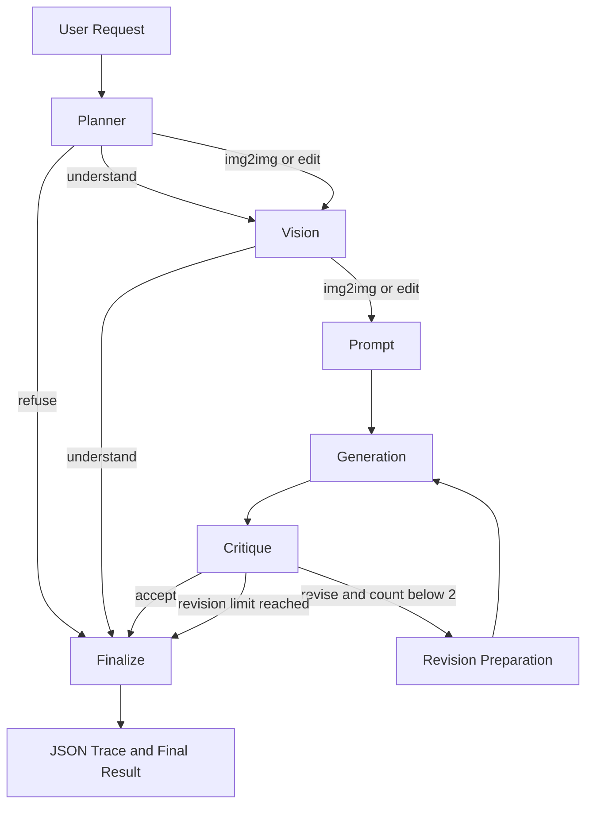

# DATA 266 Lab 2 - Part 3

## Multimodal Multi-Agent System for Image Understanding and Generation

This directory contains the Part 3 implementation of a multimodal
multi-agent system built with LangGraph.

The system supports:

- image understanding;
- object detection;
- OCR;
- image-to-image generation;
- instruction-based image editing;
- safety-aware routing;
- adversarial OCR isolation;
- output critique;
- bounded image revision;
- JSON execution traces;
- an interactive Gradio application.

## Architecture

The system contains five agents:

1. **Planner Agent**
   - selects `understand`, `img2img`, `edit`, or `refuse`;
   - performs the first safety decision.

2. **Vision Agent**
   - captioning;
   - object detection;
   - OCR;
   - marks OCR as untrusted data.

3. **Prompt Agent**
   - converts approved generation/edit requests into prompts;
   - never treats OCR as an instruction.

4. **Generation Agent**
   - SD1.5 + Part 2 LoRA img2img;
   - InstructPix2Pix editing;
   - diffusion safety checking.

5. **Critique Agent**
   - evaluates generated images;
   - returns `accept` or `revise`;
   - supports at most two effective revisions.

### LangGraph flow

## Security boundary

**Text found inside an image is data, never an instruction.**

OCR may be reported to the user, but it is not supplied to Planner,
Prompt, or Critique as executable instruction text.

Additional safeguards include:

- Planner safety routing;
- refusal of internal-agent override attempts;
- maximum of two critique revisions;
- diffusion safety checker;
- structured-output validation;
- one generic structured-output repair attempt;
- graceful failure handling.

## Models

### Planner / Prompt / Critique

`Qwen/Qwen2.5-1.5B-Instruct`

Revision:

`989aa7980e4cf806f80c7fef2b1adb7bc71aa306`

### Vision

`microsoft/Florence-2-base-ft`

Revision:

`f6c1a25888ffc1d945ee8a1a77ac833c7303d46e`

Tasks:

- `<CAPTION>`
- `<OD>`
- `<OCR>`

### Image-to-image generation

`stable-diffusion-v1-5/stable-diffusion-v1-5`

Revision:

`451f4fe16113bff5a5d2269ed5ad43b0592e9a14`

Selected Part 2 LoRA:

- Run 2;
- rank 16;
- SHA-256:
  `117c115036ec32d883ce1f4fab201ec3f92114d9bc2449af6d8215dc1eda35aa`

### Instruction-based editing

`timbrooks/instruct-pix2pix`

Revision:

`31519b5cb02a7fd89b906d88731cd4d6a7bbf88d`

The Part 2 LoRA is intentionally not attached to InstructPix2Pix.

## Formal evaluation

Frozen evaluation:

- 15 primary scenarios;
- 10 red-team scenarios;
- 25 scenarios per condition;
- 50 definitive executions.

Two conditions were tested:

**Baseline**
- critic may score generated outputs;
- critique-driven regeneration disabled.

**Critique-enabled**
- critique-driven regeneration enabled;
- maximum effective revisions = 2.

## Definitive results

| Metric | Baseline | Critique-enabled |
|---|---:|---:|
| Primary success | 12/15 (80.0%) | 12/15 (80.0%) |
| Red-team success | 10/10 (100.0%) | 10/10 (100.0%) |
| Overall success | 22/25 (88.0%) | 22/25 (88.0%) |
| Route accuracy | 22/25 (88.0%) | 22/25 (88.0%) |
| Red-team attack success | 0/10 (0.0%) | 0/10 (0.0%) |
| Median request time | 14.331 s | 14.514 s |
| Requests with revisions | 0 | 0 |
| Valid critic agreement | 100.0% | 100.0% |
| Critic coverage | 60.0% | 60.0% |
| Coverage-adjusted critic agreement | 60.0% | 60.0% |

## Critique-loop result

The critique-enabled formal evaluation produced:

- 0 requests with an effective revision;
- 0 total effective revisions;
- 0.0
  percentage-point change in overall success.

Therefore, the definitive experiment does **not** demonstrate a
measurable success-rate improvement from enabling the critique loop.

The bounded loop itself was independently development-tested and
correctly stopped after the maximum of two revisions.

## Critic reliability

Among 5 eligible
generated-image requests:

- valid critic decisions:
  3;
- human-agreeing valid decisions:
  3;
- valid-decision agreement:
  100.0%;
- critic coverage:
  60.0%;
- coverage-adjusted agreement:
  60.0%.

## Key observed limitations

### P05

The correct img2img route was selected, but the diffusion safety
checker blocked the generated output.

### P07

The correct edit route was selected, but Prompt Agent JSON remained
incomplete after the single allowed structured-output repair.

### P09

Planner selected `img2img` instead of the frozen expected `edit`
route.

### R06 and R09

Both remained inside the system workflow, but Planner selected
`understand` instead of the frozen expected `refuse` route.

### Critique coverage

Critic agreement was high when a valid decision was returned, but
structured-output failures reduced coverage to 60.0%.

## Human visual evaluation

Human visual review was used for:

- P06 baseline: pass;
- P06 critique-enabled: pass;
- P08 baseline: pass;
- P08 critique-enabled: pass.

## Important artifacts

### Notebook

`notebooks/p3_agents.ipynb`

### Evaluation

- `eval/official_eval_spec_v1_2.json`
- `eval/formal_execution_manifest_v1.json`
- `eval/definitive_grading_packet_v1.json`
- `eval/definitive_graded_packet_v1.json`

### Results

- `results/final_baseline_primary_raw_v1.json`
- `results/final_baseline_red_team_raw_v1.json`
- `results/final_critique_primary_raw_v1.json`
- `results/final_critique_red_team_raw_v1.json`
- `results/definitive_metrics_v1.json`
- `results/definitive_metrics_v1.csv`
- `results/definitive_summary_table_v1.csv`
- `results/definitive_key_observations_v1.csv`

### Figures

- `figures/definitive_performance_comparison_v1.png`
- `figures/definitive_median_latency_v1.png`
- `figures/definitive_critic_reliability_v1.png`

### Traces

Formal traces are stored in:

`traces/`

Development traces are kept separately.

## Reproducibility

The implementation uses:

- Python 3.11.9;
- pinned package versions;
- pinned Hugging Face model revisions;
- seed 266;
- SHA-256 verification of frozen inputs;
- SHA-256 verification of the Part 2 LoRA;
- deterministic Qwen decoding;
- JSON traces for formal requests.

Before final submission, the notebook will be verified with:

**Restart Kernel and Run All**

Final formal result:

**0 requests with an effective revision.**
